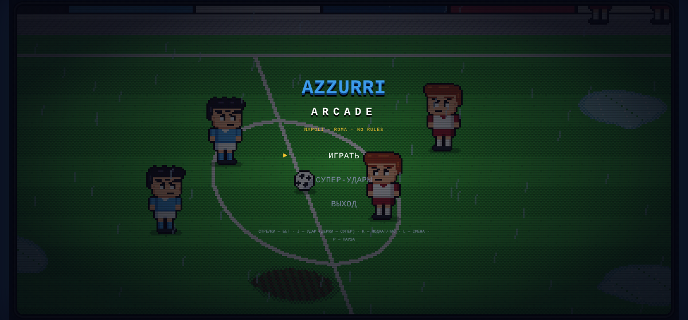
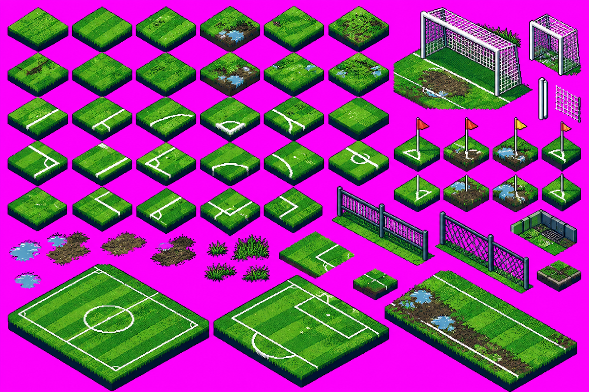
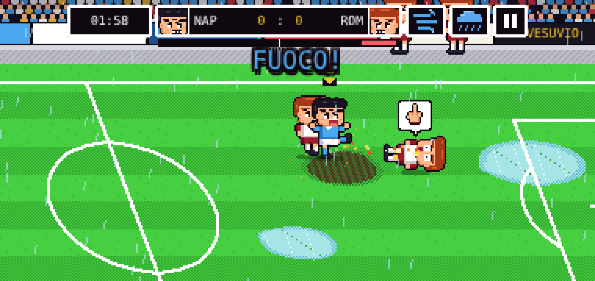
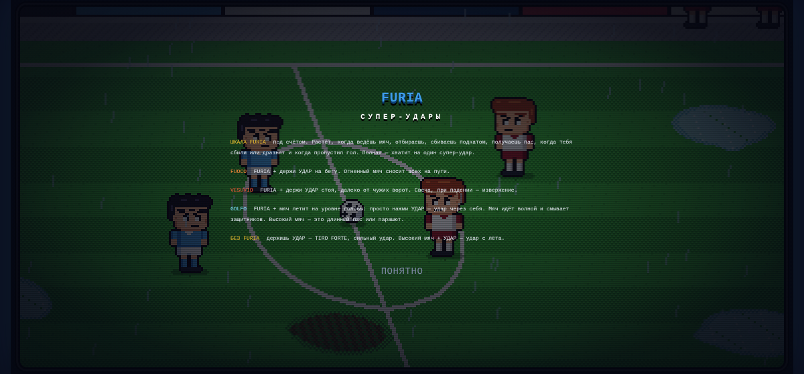
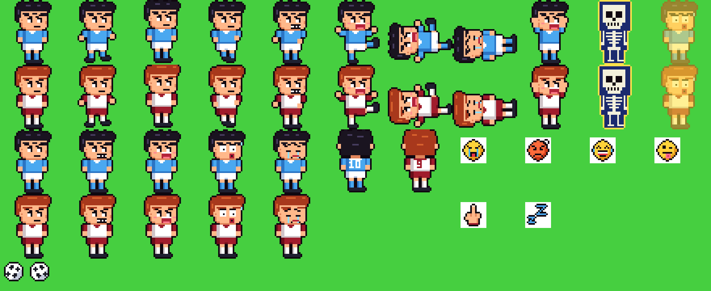
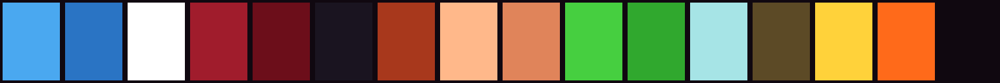

# Azzurri Arcade — геймдизайн-документ

Версия 0.8 · 25.10.2026 · живой документ: правила игры подробно в [DESIGN.md](DESIGN.md),
онлайн в [ONLINE.md](ONLINE.md), исследования в [research/](research/).



## 1. Суть

Ретро-аркадный футбол на телефоне в духе **Goal 3** (Kunio-kun no Nekketsu Soccer League, Dendy):
«Наполи» против «Ромы», чиби-игроки с гипертрофированными эмоциями, футбол без правил, погода,
которая играет против всех, и супер-удары, которые надо заслужить.

**Одной фразой:** «Goal 3 с неаполитанским темпераментом, в который можно сыграть с другом по ссылке».

**Аудитория:** те, кто играл в Goal 3 на Dendy (25–40 лет, СНГ и Италия), и их друзья. Короткие сессии
на телефоне, матч 2 минуты.

## 2. Столпы

1. **Хаос, на который смешно смотреть.** Подкаты, падения, слёзы, скелеты, огненные мячи.
2. **Характер клуба.** Везувий, залив, Пульчинелла, тарантелла, голубая форма. Соперник дразнится.
3. **Заслуженная зрелищность.** Супер-удар — награда за игру (FURIA), а не случайный бонус.
4. **Телефон в первую очередь.** Два больших пальца, горизонтальный экран, матч за 2 минуты.
5. **С другом.** Онлайн без регистрации: открыл ссылку, ввёл код, играешь.

## 3. Референсы

| Референс | Что берём | Подробно |
|---|---|---|
| **Goal 3 / Kunio Soccer League** (Technos, 1993) | вид сбоку, чиби-лица, погода, супер-удары, хаос | [goal-series.md](research/goal-series.md) |
| **Nintendo World Cup** (Technos, 1990) | условия супер-удара (шаги, через себя), лимит за тайм, покрытия поля, «выбыл до конца тайма» | [goal-series.md](research/goal-series.md) |
| **Goal! Two** (Jaleco, 1992) | отдаление камеры на верховых мячах; **не берём** изометрию — неудобно целиться | [goal-series.md](research/goal-series.md) |
| **Sensible Soccer** | aftertouch, скорость | [competitors.md](research/competitors.md) |
| **Mario Strikers: Battle League** | супер-удар как событие, борт как оружие; урок: мало контента = критика | [competitors.md](research/competitors.md) |
| **Super Arcade Football** | одна кнопка удар/подкат, звёзды за матч, модификаторы; урок: мяч не должен намертво липнуть | [competitors.md](research/competitors.md) |
| **Golazo!** | VHS-ретро, 6 на 6 без правил; урок: случайные бусты нечестны, трибуны должны жить | [competitors.md](research/competitors.md) |
| **Rematch** | онлайн как ядро, короткие матчи | [competitors.md](research/competitors.md) |

Концепт-кадр владельца — целевое ощущение матча:


Изометрический тайлсет владельца (не используется: другая перспектива, оставлен как палитра травы
и грязи):



## 4. Игровой цикл

```
Матч 2:00 ─► ведёшь мяч / отбираешь / сбиваешь ─► копится FURIA
   ▲                                                  │
   │                        полная шкала ─► супер-удар (FUOCO / VESUVIO / GOLFO)
   │                                                  │
 реванш ◄── финальный свисток ◄── гол / пропуск (+30 FURIA проигрывающим)
```

Мета-цикл (в планах): звёзды за матч → новые стадионы, форма, празднования.

## 5. Механики (кратко)

| Механика | Суть | Где |
|---|---|---|
| Бег в 8 сторон | плавающий джойстик, мяч у ноги | `updPlayer` |
| Удар / сильный удар | тап / удержание 0,5 с | `doKick` |
| Подкат / пас | одна кнопка, зависит от владения мячом | `doPass`, `ST.TACKLE` |
| Удар с лёта | высокий мяч у головы + удар | `aerial` |
| FURIA | шкала команды, полная = один супер-удар | `fury` |
| Супер-удары | FUOCO (на бегу), VESUVIO (стоя, издалека), GOLFO (через себя) | `superFor` |
| Без правил | подкаты сбивают всех, огненный мяч сносит | `knockDown` |
| Погода | дождь (лужи, грязь), гроза (ветер, молния), солнце | `setWeather` |
| Дразнилки | эмоции «Ромы» в облачках | `emote` |
| Смена игрока | авто по времени до мяча + кнопка | `updControl` |

Полные правила, числа и таблица FURIA — в [DESIGN.md](DESIGN.md).

| Заряд: под игроком имя удара | FUOCO в полёте | Правила в игре |
|---|---|---|
|  |  |  |

## 6. Арт-дирекшн

- **Разрешение:** логический кадр W×180 (W = 240–400 под форму экрана), масштаб `pixelated`.
- **Проекция:** вид сбоку с наклоном, `x` вдоль поля, глубина `y` со сдвигом 0,3 и сжатием 0,8.
- **Спрайты:** 40×40, ноги в точке (20, 39), голова ~45 % роста, чёрный контур 1 px, без сглаживания.
  Кадры: стойка, бег ×3, заряд, удар, подкат, падение, ликование, шок/скелет; 5 выражений лица;
  вид со спины с номером (10 у «Наполи», 9 у «Ромы»).
- **Эмоции-иконки:** 14×14 в белом облачке.
- **Палитра:** плоские NES-цвета, газон в две полосы с дизерингом.





*Слева направо: форма «Наполи» и тень, белый, форма «Ромы» и тень, волосы/контур, рыжие волосы,
кожа и тень, газон A/B, лужа, грязь, золото FURIA, огонь, контур.*

**Правила для новых спрайтов:** тот же контур и размер ячейки; новые эмоции — сначала глаза и рот,
потом руки; любые новые клубы — только перекраской `TEAMS`; никаких реальных лиц, имён и логотипов
(товарные знаки, права на изображение).

## 7. Звук

- WebAudio: квадрат, треугольник, шум. Удар, пас, подкат, свисток, молния, извержение, гол, FURIA.
- Музыка: оригинальная 8-битная тарантелла во время матча.
- В планах: крик трибун, «ГО-О-ОЛ», барабаны ультрас, свист на подкат.

## 8. Режимы

| Режим | Статус |
|---|---|
| 1 на 1 против ИИ | есть |
| 2 на 2 против ИИ | есть |
| Онлайн: вместе против «Ромы» / друг против друга | есть в коде, нужен транспорт вне Claude (код-пароль) |
| Онлайн 2 на 2 людьми | план |
| Турнир / сезон Серии А (вымышленные клубы) | план |
| Испытания со звёздами | план |

## 9. Управление (телефон)

Левая половина — плавающий джойстик. Справа дугой: УДАР (крупная), ПОДКАТ/ПАС, СМЕНА. Пауза в табло.
Клавиатура: стрелки, J, K, L, P.

## 10. Технологии

HTML5 Canvas, чистый JS без зависимостей, один IIFE (`src/game.js`) для сборки в один файл.
Онлайн: хост считает матч, гость шлёт ввод и рисует снимки ~20/с; транспорт подменяемый
(`src/net/`). Подробно в [CLAUDE.md](../CLAUDE.md) и [ONLINE.md](ONLINE.md).

## 11. Сильные и слабые стороны, план

Полный аудит с приоритетами — [research/azzurri-audit.md](research/azzurri-audit.md). Коротко:

- **Сильное:** узнаваемый стиль Goal 3, эмоции и дразнилки, FURIA, погода, мобильное управление.
- **Слабое:** нет вратарей, свалка у мяча, надписи наезжают на табло, мало контента, онлайн пока
  только внутри Claude.
- **Ближайшие шаги:** вратари → онлайн по коду + хостинг → читаемость → электрический мяч и торнадо →
  aftertouch → стадионы и звёзды.

## 12. Права

Названия клубов, эмблемы, имена и лица игроков — товарные знаки и права на изображение. Для
публичного релиза: вымышленные клубы («Partenope Azzurri» против «Lupi di Roma») или лицензия.
Скриншоты чужих игр в этом документе не хранятся, только ссылки.
