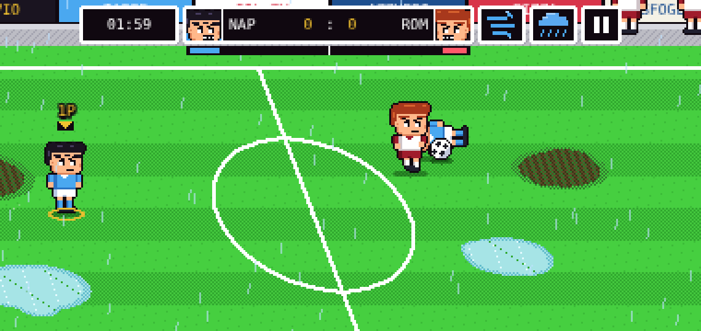
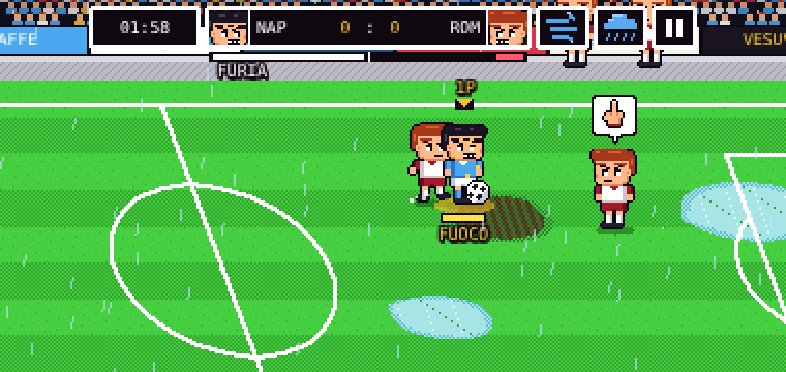
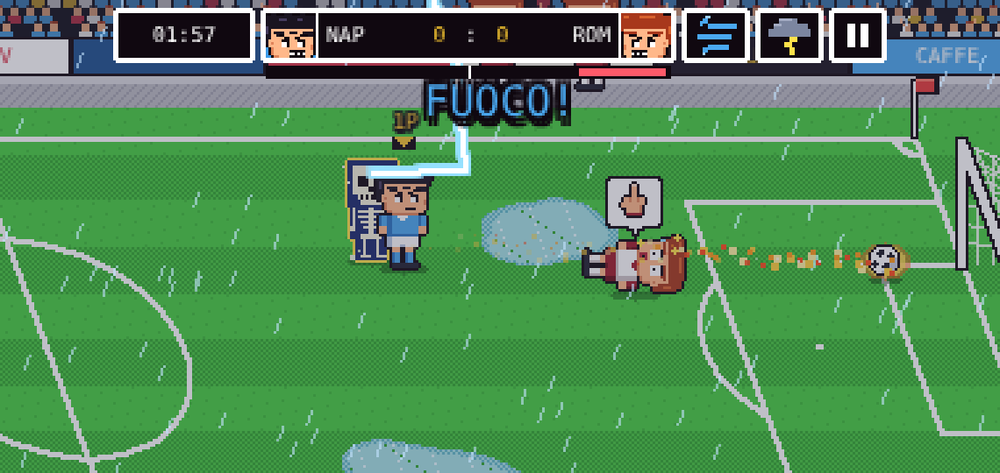
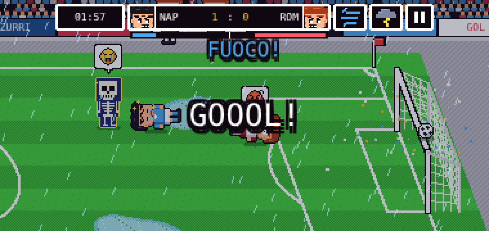

# Azzurri Arcade: сильные и слабые стороны (аудит v0.8)

Честный разбор текущей сборки по скриншотам и по сравнению с референсами
([goal-series.md](goal-series.md), [competitors.md](competitors.md)).

| Матч под дождём | Заряд FUOCO | Молния: скелет | Сбили и дразнят |
|---|---|---|---|
|  |  |  |  |

## Сильные стороны

**Графика**
- Узнаваемый Goal 3-вид сбоку с прокруткой, газон полосами, трибуны и щиты.
- Чиби-спрайты 40×40 с толстым контуром, 5 выражений лица, скелет от молнии, слёзы, звёзды.
- Всё рисуется кодом: ноль картинок, мгновенная загрузка, легко перекрашивать команды.
- CRT-фильтр, хит-стоп, тряска, вспышки — удары ощущаются.

**Механика**
- FURIA: супер-удар надо заработать, есть читаемый индикатор у обеих команд (урок Golazo!).
- Три супер-удара с разными условиями, удар через себя по верховому мячу.
- Погода влияет на игру: лужи, грязь, ветер, молния.
- Дразнилки соперников — то, чего нет ни у одного конкурента.
- ИИ «Ромы» специально слабее, матч проходим новичком.

**Платформа**
- Телефон в приоритете: плавающий джойстик, адаптивная ширина кадра, вибрация.
- Онлайн уже работает по модели «хост считает, гость рисует», транспорт подменяемый.

## Слабые стороны (по важности)

1. **Нет вратарей.** Мяч в пустые ворота слишком прост, нет сейвов — главного драматического
   момента футбола. *Исправить первым.*
2. **Свалка у мяча.** Четыре игрока слипаются в один ком (видно на скриншотах), непонятно, у кого
   мяч. Нужны: подсветка владельца мяча, расталкивание сильнее, ИИ-партнёр держит позицию.
3. **Надписи наезжают на табло.** «FUOCO!», «FURIA» и баннеры пересекаются с HUD и щитами.
   Нужна отдельная полоса для объявлений под табло.
4. **Мало контента.** Один стадион, две команды, один режим матча. Golazo! и Mario Strikers ругают
   ровно за это.
5. **Онлайн только внутри одной организации Claude.** Нужен свой транспорт (docs/ONLINE.md).
6. **Удары без «подкрутки».** Нет aftertouch, все удары по прямой, кроме GOLFO.
7. **Нет удара головой и прыжка.** Верховые мячи можно только бить с лёта.
8. **Нет прогресса.** Ни очков, ни звёзд, ни разблокировок: после пары матчей незачем возвращаться.
9. **Звук.** Нет голоса трибун и комментатора-«ГОЛ!» (Golazo! хвалят именно за атмосферу).
10. **Кадр «шок» второй фазы** (жёлтая заливка) выглядит грязно — переделать в мигание контура.

## Бэклог по приоритету

| # | Задача | Почему | Референс |
|---|---|---|---|
| 1 | Вратари с ныряниями и сейвами, ИИ + ручное управление в 1 на 1 | нет драмы | все |
| 2 | Онлайн по коду (PeerJS) и хостинг | цель владельца | Rematch |
| 3 | Полоса объявлений, подсветка владельца мяча | читаемость | Goal! Two (минус) |
| 4 | Электрический мяч после молнии, торнадо | погода как в оригинале | Goal 3 |
| 5 | Aftertouch для супер-ударов | контроль удара | Sensible Soccer |
| 6 | Тайминг-кнопка супер-удара (идеально = +сила) | скилл | Mario Strikers |
| 7 | Удар головой / прыжок | верховая игра | Goal! Two, NWC |
| 8 | Стадионы: лёд, песок пляжа, ночной матч | покрытия | NWC |
| 9 | Звёзды за матч и разблокировка формы/празднований | реиграбельность | Super Arcade Football, Golazo! |
| 10 | Живые трибуны: волна, файеры, крик «ГОЛ!» | атмосфера | Golazo! (минус) |
| 11 | Приказы партнёру | тактика | Goal 3, NWC |
| 12 | Отдаление камеры на верховом мяче | обзор | Goal! Two |
