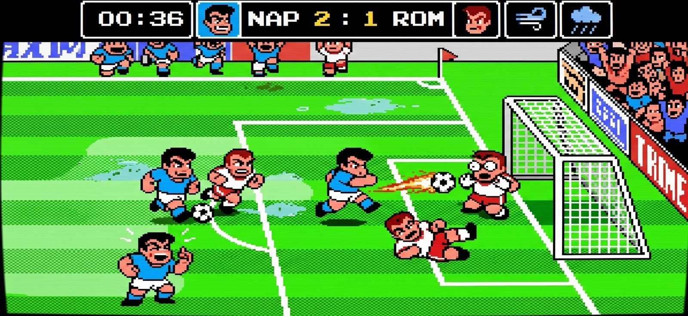

# Серия Goal и её родня на NES: графика и механика

Что называют «Goal 3» у нас и чем от него отличается Goal! Two. Разбор нужен, чтобы понимать, что
именно мы берём у оригиналов, а что делаем по-своему.

> Названия. **«Goal 3»** — так на пиратских картриджах Dendy продавали японскую игру Technos
> **Kunio-kun no Nekketsu Soccer League** (Famicom, 23.04.1993). К серии Jaleco она отношения
> не имеет. **Goal! Two** (Jaleco, NES, 1992) — отдельная игра другой компании. У Technos до этого
> была **Nintendo World Cup** (1990), из которой выросла Soccer League.

---

## 1. Kunio-kun no Nekketsu Soccer League («Goal 3»), Technos, 1993

*Концепт-кадр от владельца проекта: так должен ощущаться наш матч. Это не скриншот оригинала.
Скриншоты оригинала: [MobyGames](https://mobygames.com/game/25090/kunio-kun-no-nekketsu-soccer-league),
[GiantBomb](https://www.giantbomb.com/games/3030-2433/).*

### Графика
- Вид сбоку с наклоном: поле прокручивается по горизонтали, глубина передана сдвигом и сжатием по
  вертикали. Тот же приём у нас (`SK`, `SY` в game.js).
- Супердеформированные персонажи Kunio: голова почти половина роста, утрированные лица, крупные
  кадры эмоций (боль, восторг, злость).
- Яркая плоская NES-палитра, чёрный контур, полосатый газон, трибуны сверху кадра.
- Мелкие игроки на большом поле: читается позиционная игра, но лица видны только на заставках.

### Механика
- **6 на 6**, игрок ведёт одного капитана из 12 на выбор, позиции назначаются свободно, вплоть до
  вратаря. Остальными командует ИИ, а им можно отдавать команды: «пасуй», «бей», «обороняйся»,
  и выбирать атакующий или оборонительный стиль.
- **Супер-удары**: в сборной Японии у каждого игрока свой удар разной силы; в режиме Match у всей
  команды один общий супер-удар, и выполнять его может только капитан.
- **Погода** видна до матча и меняет игру: торнадо подхватывает и швыряет игроков; молния сбивает
  с ног и **электризует мяч**, после чего он ведёт себя опасно и непредсказуемо; после дождя на поле
  лужи и грязь, в которых вязнут и скользят.
- После гола можно выбрать победный танец для трибун.
- Режимы: N.League (1–2 игрока, только за Японию), Match (до 4 игроков против друг друга или в одной
  команде), серия пенальти; три уровня сложности.

### Сильные стороны
- Хаос, который смешно смотреть со стороны: удары, падения, торнадо, электрический мяч.
- Погода не косметика, а отдельный соперник: из-за неё матчи не похожи друг на друга.
- Супер-удары привязаны к персонажам: игрок запоминает «свой» удар.
- Команды ИИ-партнёрам дают тактику при управлении одним героем.
- Локальная игра вчетвером.

### Слабые стороны
- Мало команд: в одиночной лиге только Япония, в игре вдвоём девять сборных.
- Не симулятор и не менеджер: глубины «настоящего» футбола нет.
- Читаемость: на мелких спрайтах в свалке сложно понять, у кого мяч.
- Японский текст, официально на Западе на NES не выходила, отсюда пиратская слава «Goal 3».

---

## 2. Nintendo World Cup (Nekketsu Kōkō Dodgeball-bu: Soccer-hen), Technos, 1990

Скриншоты: [MobyGames](https://mobygames.com/game/nes/nintendo-world-cup),
[Википедия](https://en.wikipedia.org/wiki/Nintendo_World_Cup).

### Механика
- **6 на 6**: вратарь, два защитника, полузащитник, два нападающих. Управляешь одним, остальным даёшь
  команду пасовать или бить.
- Офсайда нет, фолы не наказываются. Если раз за разом сбивать соперника, он **выбывает до конца
  тайма**.
- **Супер-удары: до 5 за тайм на игрока.** Срабатывают при ударе через себя, при большинстве
  ударов головой в прыжке или **после определённого числа шагов с мячом**. У каждой команды свой
  супер-удар.
- **Покрытия поля**: лёд, песок, грунт, и они сильно меняют движение игроков и мяча.
- До 4 игроков (NES Four Score / Satellite).

### Сильные стороны
- Понятное условие супер-удара (шаги, удар через себя) рождает тактику: «разгони и пробей».
- Лимит супер-ударов за тайм не даёт их спамить.
- Покрытия поля сами по себе дают разнообразие.

### Слабые стороны
- Шесть разных команд в NES-версии отличаются в основном палитрой и супер-ударом.
- Нет погоды и событий, которые появились в Soccer League.

---

## 3. Goal! Two, Jaleco, 1992

Скриншоты: [Википедия](https://www.wikipedia.com/wiki/Goal!_2),
[NES Guide](https://nesguide.com/games/goal-two/),
[GOG (переиздание)](https://www.gog.com/en/game/jaleco_sports_goal_two).

### Графика
- **Диагональный изометрический вид**, а не вид сбоку. Для NES графика сильная, хотя ограничения железа
  всё равно заметны.
- **Камера отдаляется, когда мяч взлетает**, чтобы игрок успел встать под него.

### Механика
- Две кнопки. Вратари на автомате или вручную, фолы и офсайд можно выключить. Есть удары через
  себя и головой.
- Режимы Super Cup и Exhibition, оба на двоих.

### Сильные стороны
- Ближе к «настоящему» футболу: правила, удары головой, европейские сборные.
- Отдаление камеры на верховых мячах — удачная находка.

### Слабые стороны
- Из-за изометрии неудобно целиться: мяч уходит не туда, пасы неточные.
- Когда сталкиваются трое, игроки «замирают», пока кто-то не сдвинется.
- В переиздании перемотку можно абьюзить в игре вдвоём.

---

## Что мы берём, а что нет

| Идея из оригиналов | У нас | Решение |
|---|---|---|
| Вид сбоку с наклоном, горизонтальный скролл (Technos) | есть | оставляем: это наш стиль, изометрия Goal! Two мешает целиться |
| Чиби-персонажи с крупными эмоциями | есть: 5 выражений, скелет, слёзы, звёзды | расширять кадрами |
| Без фолов, сбивать можно всех | есть | добавить «выбыл до конца тайма» как у NWC? см. бэклог |
| Супер-удар по условию (шаги, удар через себя, лимит за тайм) | шкала FURIA, GOLFO через себя | условия ближе к NWC: сделать «N шагов с мячом» вторым способом набрать FURIA |
| Погода: лужи, грязь, молния | есть + ветер | **добавить электрический мяч после молнии** и торнадо |
| Покрытия поля (лёд, песок) | нет | новые стадионы: Санкт-Морис (лёд), пляж Мерджеллина (песок) |
| Команды партнёрам («пасуй», «бей», «держи») | нет | кнопка СМЕНА с удержанием → приказ партнёру |
| Победный танец | ликование и дразнилки | выбор празднования после гола |
| Отдаление камеры на верховом мяче (Goal! Two) | нет | лёгкий zoom-out при `ball.z > 60` |
| До 4 игроков | 1 + онлайн 2 | онлайн 2 на 2 людьми (4 телефона) — позже |

## Источники
- [GiantBomb: Kunio-kun no Nekketsu Soccer League](https://www.giantbomb.com/games/3030-2433/)
- [Home of the Underdogs: Kunio-kun no Nekketsu Soccer League](https://homeoftheunderdogs.net/game.php?id=3623)
- [MobyGames: Kunio-kun no Nekketsu Soccer League](https://mobygames.com/game/25090/kunio-kun-no-nekketsu-soccer-league)
- [Wikipedia: Nintendo World Cup](https://en.wikipedia.org/wiki/Nintendo_World_Cup)
- [Games Asylum: Jaleco Sports: Goal! 2 review](https://www.gamesasylum.com/2026/04/08/jaleco-sports-goal-2-review/)
- [NES Guide: Goal! Two](https://nesguide.com/games/goal-two/)
